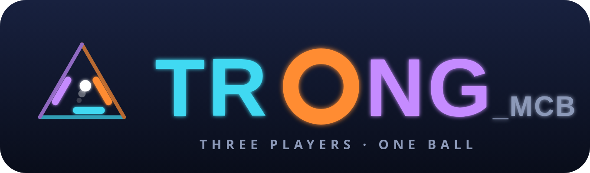
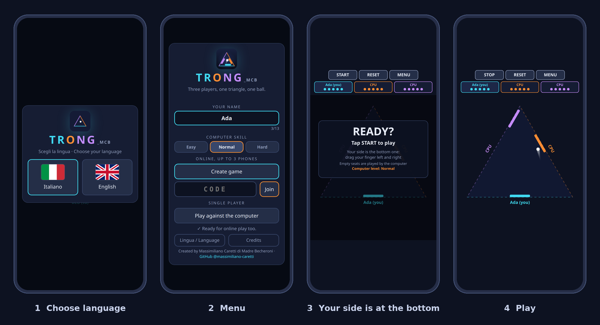
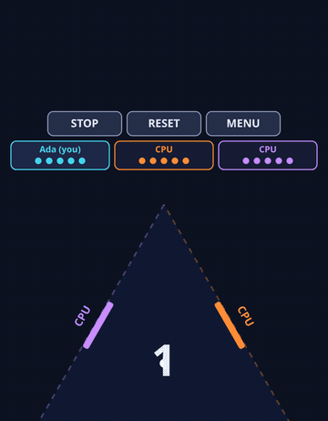
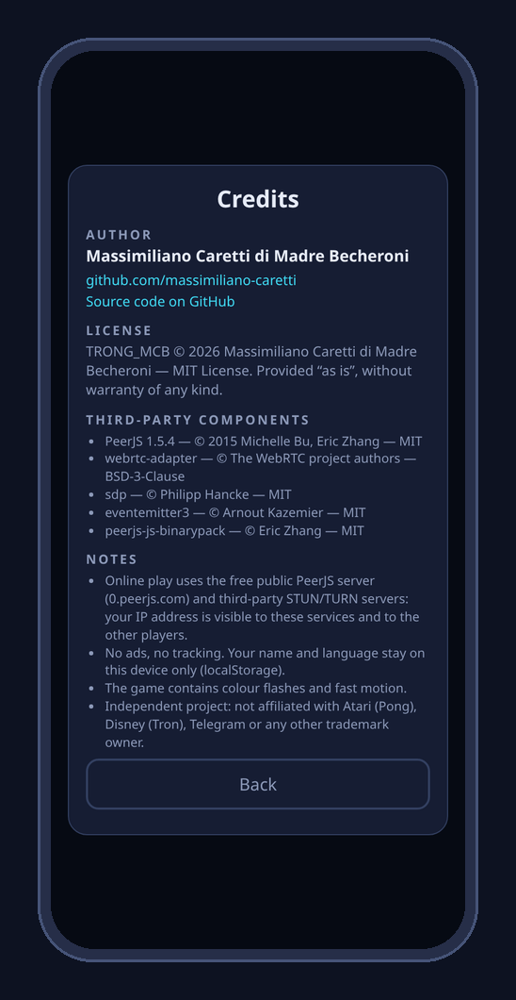
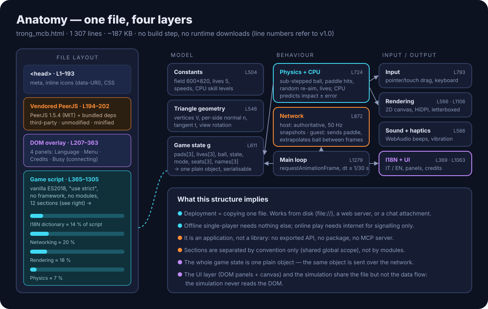
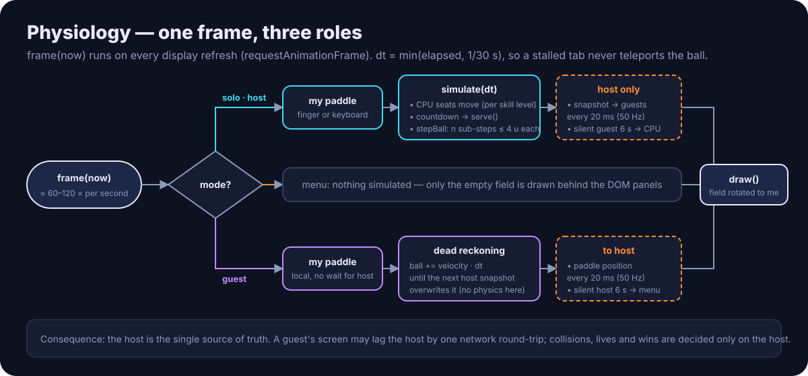
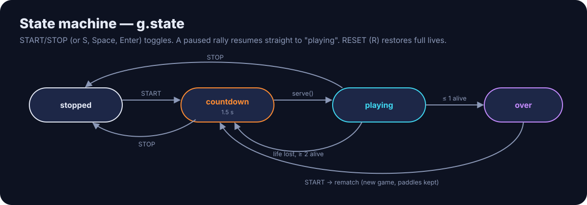
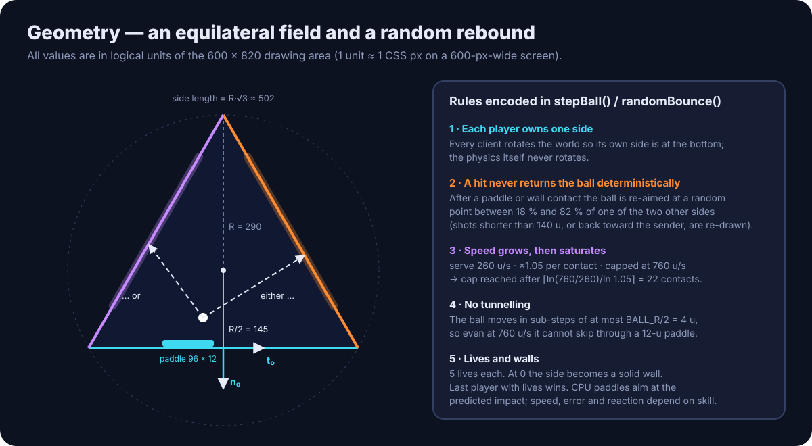
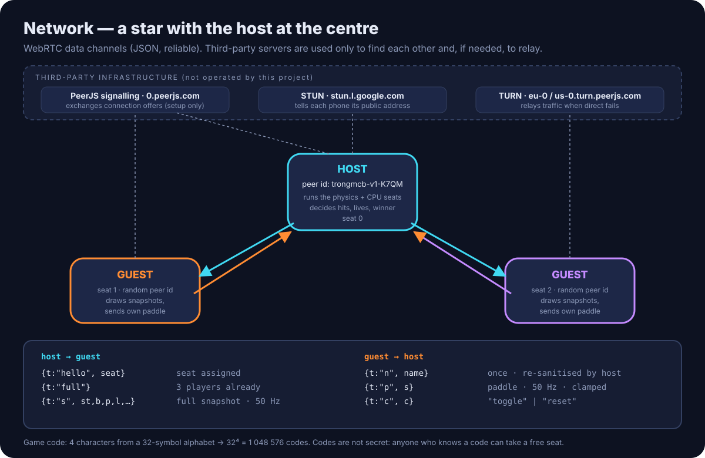
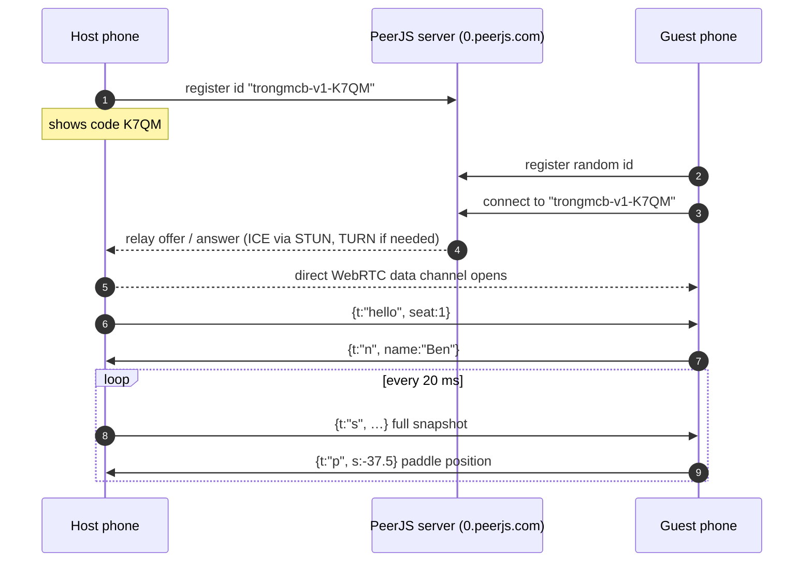

<p align="center">
  
</p>

<p align="center">
  <b>A three-player paddle game on a triangular field, delivered as one self-contained HTML file.</b><br>
  Play against the computer offline, or with up to two friends online, phone to phone over WebRTC.
</p>

<p align="center">
  
  
  
  
  
</p>

<p align="center">
  <a href="#1-what-it-is--and-what-it-is-not">What it is</a> ·
  <a href="#2-quick-start">Quick start</a> ·
  <a href="#3-features-with-examples">Features</a> ·
  <a href="#4-user-manual">Manual</a> ·
  <a href="#5-how-it-works">How it works</a> ·
  <a href="#8-limitations-and-not-yet-implemented">Not yet implemented</a> ·
  <a href="#9-disclaimers">Disclaimers</a> ·
  <a href="#10-credits-licenses-and-trademarks">Credits</a>
</p>

---

<table>
<tr>
<td width="62%"></td>
<td width="38%" align="center"><br><sub>Real capture, headless Chromium. All three seats driven by the built-in CPU for the demo.</sub></td>
</tr>
</table>

## At a glance

| | |
|---|---|
| **What you get** | One file, `trong_mcb.html` (≈ 187 KB). Open it in a browser and play. |
| **Who plays** | 1 human vs 2 CPU · 2 humans + 1 CPU · 3 humans. Empty seats are always filled by the CPU. |
| **Computer skill** | Three levels — Easy, Normal, Hard — measured, not guessed (§3.2). |
| **Where it runs** | Any modern browser with Canvas 2D; online play also needs WebRTC. Designed for phones held upright; works with a keyboard on desktop. |
| **Network needed?** | No for single player. Yes for online play (to find each other; the game data then flows directly between phones when possible). |
| **Languages** | Italian and English, chosen with a flag every time the game opens. |
| **Data collected by the author** | None. No analytics, no ads, no cookies, no accounts. |
| **License** | MIT for the project; embedded PeerJS stack under MIT / BSD-3-Clause (see [Credits](#10-credits-licenses-and-trademarks)). |

---

## 1. What it is — and what it is not

TRONG_MCB is a **game application**. Precision about its nature avoids wrong expectations:

| Question | Answer | Evidence in the code |
|---|---|---|
| Is it a playable app? | **Yes.** | `trong_mcb.html` runs as-is. |
| Is it a library with a public API? | **No.** Nothing is exported; there is no package to import. | All code lives in one classic `<script>` with shared global scope. |
| Is it an MCP server or an AI tool? | **No.** It exposes no protocol for agents. | No server, no tool schema, no endpoint. |
| Is the user interface separable from the engine? | **Partially, by convention only.** The simulation never reads the DOM, but UI and engine share one file and one global scope. The UI is the product, not an optional add-on. | §5.1 *Anatomy* |
| Does it need a server you must run? | **No.** Online play relies on free public third-party infrastructure (§5.5). | `new Peer(...)` with PeerJS defaults |

## 2. Quick start

**A · On a computer**

```bash
git clone https://github.com/massimiliano-caretti/TRONG_MCB.git
cd TRONG_MCB
# either double-click trong_mcb.html, or serve it locally:
python3 -m http.server 8000      # then open http://localhost:8000/trong_mcb.html
```

**B · On phones (the intended use)**

1. Send `trong_mcb.html` to each phone (any chat app, e-mail, cloud drive).
2. Open it **in the real browser**: Chrome on Android, Safari on iPhone.
   In-app previews (e.g. Telegram's built-in viewer) block scripts; the file then shows a red bilingual notice explaining how to open it properly.
3. Tap 🇮🇹 or 🇬🇧, type a name, choose a mode.

**C · From any static web host**

Upload the single file to any static host (GitHub Pages, Netlify, an S3 bucket, a school server). No build step, no configuration.

## 3. Features, with examples

<details open>
<summary><b>3.1 Single player against the computer</b> — works fully offline</summary>

> **Example.** On a train with no signal: open the file → 🇬🇧 → name `Ada` → **Play against the computer** → **START**.
> You defend the bottom side; the orange and purple sides are CPU players.

The CPU predicts where the ball will cross its side and moves its paddle there. How fast it moves, how precisely it aims and how quickly it reacts depend on the skill level (§3.2).
</details>

<details open>
<summary><b>3.2 Computer skill: Easy · Normal · Hard</b></summary>

> **Example.** A child plays on **Easy**; an experienced player picks **Hard**. In the menu, tap the level under *Computer skill* before starting. The choice is remembered on the device and shown on the *READY?* panel (`Computer level: Hard`).

In an online game the level chosen by the **host** applies, because the host's phone runs the CPU seats; guests see it on their *READY?* panel.

**Model.** Each level changes three parameters of the same algorithm — nothing else:

| Level | Max paddle speed | Aiming error (re-drawn at every bounce) | Reaction delay after each bounce |
|---|---|---|---|
| Easy | 260 u/s | ±55 u | 0.20 s |
| Normal *(= behaviour of v1.0)* | 330 u/s | ±30 u | 0 s |
| Hard | 560 u/s | ±12 u | 0 s |

For scale: a paddle hit succeeds when the paddle centre is within ±53.6 u of the ball, so aiming errors above that value cause misses even with a perfectly placed paddle.

**Measurement.** The levels were calibrated by simulation, not by feel. Three CPUs of the same level play each other for 60 minutes of game time (216 000 physics steps of 1/60 s, served from the real game code in headless Chromium). *Save rate* = paddle hits ÷ (paddle hits + lives lost).

| Level | Saves | Misses | Save rate | 95 % CI (Wilson) | Mean rally (hits per life lost) |
|---|---:|---:|---:|---|---:|
| Easy | 3 709 | 419 | 89.8 % | 88.9 – 90.7 % | 8.8 |
| Normal | 5 660 | 236 | 96.0 % | 95.5 – 96.5 % | 23.9 |
| Hard | 6 735 | 154 | 97.8 % | 97.4 – 98.1 % | 43.7 |

The confidence intervals do not overlap, so the three levels are measurably distinct; mean rally length roughly doubles or triples from one level to the next. These figures describe CPU-vs-CPU play; how a level *feels* against a human depends on that human's skill and device.
</details>

<details>
<summary><b>3.3 Online game for up to three phones</b></summary>

> **Example.** Ada, Ben and Cleo are in different cities.
> 1. Ada taps **Create game** → the field shows the code, e.g. `K7QM`.
> 2. Ada taps **INVITE** and sends the code.
> 3. Ben and Cleo type `K7QM` and tap **Join**. Each sees their own side at the bottom.
> 4. Anyone taps **START**.

If only Ben joins, the third side is played by the CPU. If Ben leaves, the CPU takes over that side (at most 6 s later) and the game continues.
</details>

<details>
<summary><b>3.4 Sharing the game code</b></summary>

**INVITE** uses, in order: the system share sheet (Web Share API) → copy to clipboard → a Telegram share link as last resort.

> **Example message sent (English UI):** `Play TRONG_MCB with me! Open the game, tap "Join" and enter the code: K7QM`
</details>

<details>
<summary><b>3.5 Bilingual interface (Italian / English)</b></summary>

Every launch starts with a flag screen. The choice translates menus, in-game text, notices, error messages and the invitation text. It is remembered on the device and can be changed from **Lingua / Language** in the menu.

| 🇮🇹 Italiano | 🇬🇧 English |
|---|---|
| `PRONTI?` · `Tocca AVVIA per giocare` | `READY?` · `Tap START to play` |
| `VINCE Ada` | `Ada WINS` |
| `Codice non trovato…` | `Code not found…` |
</details>

<details>
<summary><b>3.6 Elimination and walls</b></summary>

Each player has 5 lives. At zero, that side turns into a solid grey wall and the ball rebounds from it; the eliminated player keeps watching. The last player with lives wins; **START** begins a rematch.
</details>

<details>
<summary><b>3.7 Credits screen inside the app</b></summary>



**Credits** in the menu shows author, link to this repository, license, every third-party component with its license, and the privacy, photosensitivity and trademark notes summarised in §9.
<br clear="right">
</details>

## 4. User manual

### 4.1 Screens

```
 open file ──► [ Language: 🇮🇹 | 🇬🇧 ] ──► [ Menu ] ──► Play against the computer ─┐
                       ▲                     │  ├──► Create game ──► code shown ───┤──► [ Field ]
                       └── Lingua/Language ──┘  ├──► Join (4-char code) ─────────┘       │
                                                └──► Credits                     MENU ◄──┘
```

In the menu, the **name** (required, max 13 characters) and the **computer skill** (Easy · Normal · Hard) apply to whatever mode you start next. Both are remembered on the device.

### 4.2 Controls

| Action | Touch | Keyboard |
|---|---|---|
| Move your paddle | Drag a finger left / right anywhere on the field | `←` `→` · `A` `D` · `Q` `K` |
| Start / pause / rematch | **START** / **STOP** | `S` · `Space` · `Enter` |
| Reset lives | **RESET** | `R` |
| Back to menu | **MENU** | `Esc` |
| Send the code (host) | **INVITE** | — |

Your side is **always drawn at the bottom**, whichever seat you have: each device rotates the whole field for its own player.

### 4.3 Reading the screen

| Element | Meaning |
|---|---|
| Three cards at the top | Name, colour and remaining lives (●) of each side. Your card is highlighted. |
| Dashed coloured sides | Sides still defended. A **red flash** marks the side that just lost a life. |
| Solid grey side | Eliminated player — now a wall. |
| Name along each side | Who defends it; `(you)` marks you. |
| Bar at the bottom | Notices: joins, leaves, eliminations, copied code. |

### 4.4 Rules

1. The ball is served from the centre toward a random point of a random living side.
2. Missing the ball costs one life; after 1.5 s a new serve follows.
3. **Any** contact — paddle or wall — sends the ball toward a random point on one of the **other two** sides. You cannot aim; you can only defend.
4. Every contact multiplies the speed by 1.05, from 260 up to 760 u/s.
5. Last player with lives wins.

### 4.5 Troubleshooting

| Message (EN) | Likely cause | What to do |
|---|---|---|
| Red box *"The game did not start"* | Opened in an in-app preview that blocks scripts | Open in Chrome / Safari |
| *Code not found* | Typo, or the host closed the game | Check the 4 characters; ask for a new code |
| *Network problem* | No internet, or the signalling server is unreachable | Check the connection, retry |
| *The connection service is not responding* | Public PeerJS server busy or down | Retry later; nothing local can fix it |
| *Direct connection failed. Try on Wi-Fi.* | Restrictive mobile / corporate network | Switch network; TURN relay may also be unavailable |
| *The game is already full* | Three humans already connected | — |
| *Online play needs internet (library not loaded)* | PeerJS failed to initialise | Reload the file in a supported browser |

## 5. How it works

The explanation follows a didactic order: **anatomy** (what the parts are), **physiology** (how they work together in time), then three close-ups.

### 5.1 Anatomy



### 5.2 Physiology — one frame



### 5.3 State machine



### 5.4 Geometry and bounce rule



### 5.5 Network



Joining, step by step (exactly what the code does):



### 5.6 Parameters

All values come from the constants block of `trong_mcb.html`.

| Constant | Value | Meaning |
|---|---|---|
| `VW × VH` | 600 × 820 | Logical drawing area, scaled to the screen |
| `R` | 290 | Circumradius of the triangle (side ≈ 502) |
| `PL × PT` | 96 × 12 | Paddle length × thickness |
| `BALL_R` | 8 | Ball radius |
| `BALL_START` / `BALL_SPEEDUP` / `BALL_MAX` | 260 / ×1.05 / 760 | Serve speed, growth per contact, cap (u/s) |
| `TOUCH_SPEED` / `KEY_SPEED` | 1500 / 520 | Human paddle speeds (u/s) |
| `CPU_LEVELS` | easy · normal · hard | CPU speed, aiming error and reaction per level (table in §3.2) |
| `LIVES` | 5 | Lives per player |
| `COUNTDOWN` | 1.5 s | Pause before each serve |
| `NET_SEND_MS` | 20 ms | Send interval (50 Hz) in both directions |
| `NET_TIMEOUT_MS` | 6000 ms | Silence after which a peer is considered gone |

## 6. Use by people and by AI agents

**People** use the graphical interface described in §4. That is the only supported interface.

**AI agents and automated tools** have no dedicated interface (no API, no MCP, no CLI). What *is* true, and verifiable:

- The program is a single readable, commented file, so a code assistant can study or modify it in one pass.
- The game state is a plain JavaScript object, reachable from the browser console or from automation tools such as Playwright. The screenshots and GIF in this README were produced exactly this way:

```js
// In the browser console, after starting "Play against the computer":
seats = ["cpu", "cpu", "cpu"];   // let the CPU play all three sides (demo / testing)
cpuLevel = "hard";               // "easy" | "normal" | "hard"
g.lives                          // → [5, 5, 5]   remaining lives per side
g.state                          // → "playing" | "countdown" | "stopped" | "over"
```

These are internal variables, not a stable API: names may change between versions.

## 7. Scalability and modularity — an honest assessment

| Dimension | Current state | Consequence |
|---|---|---|
| Players per game | Fixed at **3**: the triangle geometry, colour set and seat logic assume it. | Supporting N players would require an N-gon field and a generalised seat model. |
| Concurrent games | Unlimited in principle: each game is an independent host phone. No central game server exists. | Practical limit set by the free public PeerJS server, which offers no service guarantee. |
| Bandwidth | Snapshot: 174–256 bytes of JSON (measured). At 50 Hz ≈ 9–13 KB/s per guest; ≈ 17–26 KB/s host upload with 2 guests; guest upload ≈ 1.5 KB/s. Payload only, protocol overhead excluded. | Fine on Wi-Fi and 4G; no compression or delta encoding. |
| Authority | Star topology, host-authoritative. | Simple and consistent, but if the host leaves the game ends for everyone. |
| Code modularity | Twelve sections separated by comments; no modules, shared global scope. | Easy to read end-to-end; reuse of individual parts requires extracting them. |
| Localisation | One dictionary object, two languages. | Adding a language = adding one block of strings plus a flag button. |

## 8. Limitations and not yet implemented

Listed so that nobody has to discover them by surprise.

- [ ] **Host migration** — if the host leaves, the game ends; no other player takes over.
- [ ] **Guest reconnection** — a guest who drops must re-enter the code; the seat goes to the CPU meanwhile.
- [ ] **Latency compensation** — guests only extrapolate the ball linearly between snapshots; no interpolation or rollback.
- [ ] **Self-hosted signalling/TURN** — server addresses are PeerJS defaults; there is no setting to use your own.
- [ ] **Private rooms** — a 4-character code is not a password; anyone who knows it can take a free seat.
- [ ] **Anti-cheat** — the host is trusted; guest messages are sanitised and clamped, but a modified host could alter the game.
- [ ] **Notices in mixed-language games** — notices generated by the host are sent to guests in the host's language.
- [ ] **Accessibility** — the field is a `<canvas>` with no screen-reader description, no colour-blind palette and no reduced-motion mode.
- [ ] **More settings** — computer skill is selectable; lives, ball speed, sound and vibration are not.
- [ ] **Per-seat skill** — all CPU seats in a game share one level.
- [ ] **Installable app (PWA)** — no manifest or service worker.
- [ ] **Automated test suite** — this release was checked with scripted headless-Chromium runs (both languages, nine screen sizes, no JavaScript errors), but no test suite is included in the repository.
- [ ] **Cross-browser verification** — Safari and Firefox are expected to work (standard APIs only) but were not systematically tested for this release.

## 9. Disclaimers

> Please read before use. These notes protect players and the author and describe the software's limits.

- **No warranty.** The software is provided "as is", without warranty of any kind, express or implied, as stated in the [MIT License](LICENSE). The author is not liable for any damage, data loss, cost or other consequence arising from its use.
- **Photosensitivity.** The game shows moving objects, colour flashes (a red flash on the side that loses a life) and rapid motion. People with photosensitive epilepsy or similar conditions should consult a doctor before playing and stop immediately if they feel unwell.
- **Physical safety.** Play in a safe place. Do not play while driving, walking in traffic or in any situation that requires your attention.
- **Privacy — local data.** The game stores only your chosen name and language in your browser's `localStorage`. Nothing is sent to the author. Clearing the browser's site data removes them.
- **Privacy — online play.** To connect, your device contacts third-party servers (PeerJS signalling and TURN servers, a Google STUN server). As with any WebRTC connection, your **IP address** becomes visible to those services and to the other players in your game. Your chosen **name** is sent to the other players. Those services are governed by their operators' own terms and privacy policies, over which the author has no control.
- **Third-party availability.** Online play depends on free public infrastructure with no service-level guarantee. It may be slow, unavailable or discontinued at any time.
- **Sharing.** Inviting through the system share sheet or Telegram sends the code through those services under their own terms.
- **Minors.** The game contains no chat, no purchases and no user-generated content beyond a 13-character name. Parents or guardians should still supervise online play by minors.
- **Not affiliated.** TRONG_MCB is an independent, non-commercial project. It is not affiliated with, endorsed by or sponsored by Atari (owner of the *Pong* trademark), The Walt Disney Company (owner of the *Tron* trademark), Telegram, Google, the PeerJS project or any other company or trademark owner mentioned here. Names are used only to describe compatibility, technical context or the genre.
- **Accuracy of this document.** Numbers in this README were measured or read from the code of this release; future changes to the code may make them outdated.

## 10. Credits, licenses and trademarks

**Author** — Massimiliano Caretti di Madre Becheroni · [github.com/massimiliano-caretti](https://github.com/massimiliano-caretti)
Design, code, artwork, logo and documentation.

**License** — TRONG_MCB is released under the [MIT License](LICENSE). The MIT License is compatible with every embedded component below; their notices are reproduced in full in [THIRD_PARTY_NOTICES.md](THIRD_PARTY_NOTICES.md), as their licenses require.

| Component | License |
|---|---|
| PeerJS 1.5.4 — © 2015 Michelle Bu, Eric Zhang | MIT |
| webrtc-adapter — © 2014 The WebRTC project authors | BSD-3-Clause |
| sdp — © 2017 Philipp Hancke | MIT |
| eventemitter3 — © 2014 Arnout Kazemier | MIT |
| peerjs-js-binarypack — © 2012 Eric Zhang | MIT |

**Fonts, sounds, images** — none from third parties. System fonts only; sounds synthesised with the Web Audio API; flag and logo drawn as SVG by the author. National flags are public symbols.

**Trademarks** — Pong is a trademark of Atari Interactive, Inc. Tron is a trademark of The Walt Disney Company. Telegram is a trademark of Telegram FZ-LLC. Chrome and Android are trademarks of Google LLC. Safari and iPhone are trademarks of Apple Inc., registered in the U.S. and other countries. Firefox is a trademark of the Mozilla Foundation. GitHub is a trademark of GitHub, Inc. All other trademarks belong to their respective owners. Their mention implies no affiliation or endorsement.

**How to cite**

```bibtex
@software{caretti_trong_mcb_2026,
  author  = {Caretti di Madre Becheroni, Massimiliano},
  title   = {TRONG\_MCB: a three-player paddle game on a triangular field},
  year    = {2026},
  version = {1.1.0},
  url     = {https://github.com/massimiliano-caretti/TRONG_MCB},
  license = {MIT}
}
```

---

<sub>Keywords: three-player pong-like game · triangle paddle game · browser game · HTML5 canvas · single-file HTML · WebRTC · PeerJS · peer-to-peer multiplayer · mobile game · offline game · vanilla JavaScript · Italian / English.</sub>
